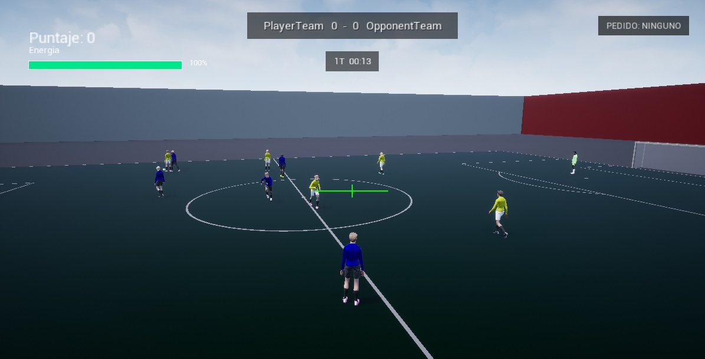
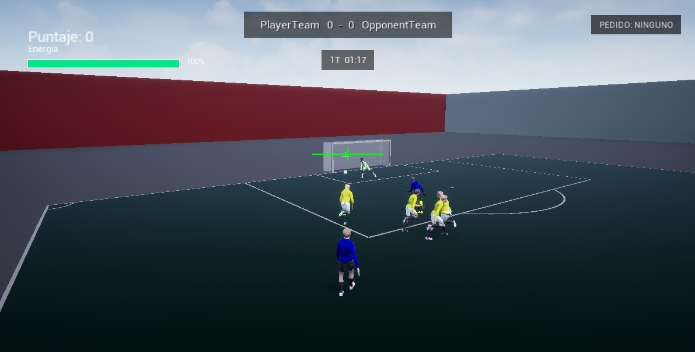
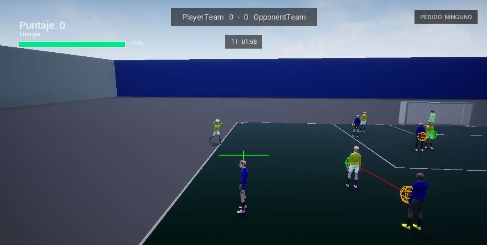

# Futbol7

[Español](README_ES.md)


**Futbol7** is a seven-a-side soccer gameplay and simulation project developed primarily in **C++ with Unreal Engine 4.27**.

The project focuses on systems programming rather than visual polish: tactical AI, match rules, player/ball interaction, goalkeepers, formations, substitutions, player attributes, animation-driven actions and instant replay.

The goal is to build a soccer match where the human-controlled player and AI-controlled teammates/opponents operate under the same rules and interact through shared tactical, physical and match-state systems.

> **Technical note:** the public project name is **Futbol7**, but the Unreal project and C++ module are still named `ThirdPersonCpp` because development originally started from Unreal's Third Person template.

> This repository is a development snapshot, not a finished commercial game or packaged release.

---

## Gameplay preview

<p align="center">
  
</p>

<p align="center">
  
</p>

<p align="center">
  
</p>

---

## Engineering highlights

Futbol7 is mainly a gameplay-programming and AI project. The codebase currently includes systems for:

- contextual team AI with attacking, defending and neutral phases
- predictive ball interception
- passing, shooting, dribbling and self-pass behavior
- tactical support, pressure, cover, marking and runs into space
- goalkeeper positioning, saves, catches and distribution
- match-state handling for soccer restarts
- kickoff, throw-in, free-kick, corner, goal-kick, offside and penalty flows
- dedicated configuration / preparation / execution state classes
- fouls, tackles and fall reactions
- aerial actions and interception planning
- nine seven-a-side formations
- coach profiles and AI coach planning
- lineups, bench players, fatigue and substitutions
- persistent tactical presets and quick tactics
- player physical, technical, tactical and goalkeeper attributes
- customizable player appearance/body variants
- first half, half-time and second-half match periods
- field geometry derived from centralized pitch dimensions
- instant replay with a ring-buffer recorder and multiple goal cameras
- gameplay-specific debug visualization

---

## High-level architecture

```text
                    ┌─────────────────────────────┐
                    │      SoccerMatchManager     │
                    │                             │
                    │ Match flow / rules / teams  │
                    │ possession / periods        │
                    │ substitutions / coach AI    │
                    └──────────────┬──────────────┘
                                   │
          ┌────────────────────────┼────────────────────────┐
          │                        │                        │
          ▼                        ▼                        ▼
┌──────────────────┐    ┌────────────────────┐    ┌────────────────────┐
│ Match states     │    │ Player / Team AI   │    │ Player profiles    │
│                  │    │                    │    │ Coach profiles     │
│ Kickoff          │    │ Positioning        │    │ Formations         │
│ Throw-in         │    │ Passing            │    │ Tactical presets   │
│ Free kick        │    │ Interception       │    │ Squad / lineup     │
│ Corner           │    │ Marking / support  │    │ Attributes         │
│ Goal kick        │    │ Goalkeeper logic   │    │ Appearance         │
│ Offside          │    │ Aerial actions     │    └────────────────────┘
│ Penalty          │    │ Tackles            │
└──────────────────┘    └──────────┬─────────┘
                                   │
                                   ▼
                         ┌────────────────────┐
                         │ Ball / animation   │
                         │ physics / NavMesh  │
                         └────────────────────┘

          ┌────────────────────────┴────────────────────────┐
          ▼                                                 ▼
┌────────────────────┐                            ┌────────────────────┐
│ Field geometry     │                            │ Instant replay     │
│ centralized dims   │                            │ sampled snapshots  │
└────────────────────┘                            └────────────────────┘
```

The architecture is evolving as gameplay systems are tested and refactored.

---

## Match state system

Soccer restarts are modeled as explicit gameplay states rather than being handled as isolated one-off events.

Examples include dedicated state classes for:

```text
Kickoff
Throw-in
Corner kick
Goal kick
Free kick / foul
Offside
Penalty
Ball-out delay
Normal play
```

Several restart types are split into three stages:

```text
Configuration
    ↓
Preparation
    ↓
Execution
```

This makes it possible to coordinate:

- ball placement
- restart taker selection
- teammate positioning
- opponent restrictions
- human input locking/unlocking
- animation timing
- transition back to open play

The state-oriented design also reduces the amount of restart-specific behavior that has to live directly inside the central match manager.

---

## Tactical AI

AI players are not designed to simply chase the ball.

Teams operate with high-level phases:

```text
Neutral
Attacking
Defending
```

Depending on context, AI orders include behaviors such as:

### In attack

- recover a loose ball
- provide short support
- support forward
- run into space
- provide width
- maintain rest defense
- compensate for teammates leaving position

### In defense

- press the ball
- protect the lane toward goal
- cover central space
- keep a compact team shape
- mark dangerous receivers

The objective is to make individual decisions subordinate to the current collective tactical situation.

---

## Predictive interception

Ball pursuit can use **future interception points** instead of only chasing the ball's current location.

The interception system models data such as:

- predicted location
- trajectory samples
- arrival timing
- player turning time
- safety margins
- ground vs aerial interception conditions

This logic is shared across multiple gameplay systems and is also used by human-controlled ball pursuit in the appropriate input modes.

---

## Passing and dribbling

The project distinguishes multiple ball-progressing intentions:

- normal passes
- passes requested by the human player
- aerial passes
- passes into space
- self-passes / dribbling touches
- restart passes

AI decision-making also considers tactical context so a teammate does not immediately treat every intentionally passed ball as an unrelated free-ball chase.

Dribbling logic includes spatial evaluation and controlled forward touches rather than relying only on permanently attaching the ball to a character.

---

## Goalkeeper systems

Goalkeepers use dedicated gameplay logic rather than the normal field-player behavior.

Implemented and evolving systems include:

- dynamic positioning relative to the ball and goal
- shot-response planning
- multiple save/catch action types
- hand possession
- protected possession while holding the ball
- distribution by hand
- drop kicks and placed-ball distribution
- penalty positioning
- recovery toward goal
- animation contact windows

Goalkeeper save actions include different catch, block, deflection and diving behaviors.

---

## Formations and team tactics

Futbol7 currently defines **nine seven-a-side formations**:

```text
1-3-2-1
1-2-3-1
1-3-3
1-2-2-2
1-3-1-2
1-2-1-2-1
1-2-1-3
1-4-1-1
1-5-1
```

Each formation contains exactly seven structural slots:

```text
1 goalkeeper + 6 field players
```

Formation slots are described independently from broad gameplay roles, allowing a player to have a general role while occupying different tactical lines or lanes.

The project also includes:

- team tactical plans
- player instructions
- persistent tactical presets
- quick-tactic slots
- an in-game formation / coach interface

---

## Coach AI

Coaches are represented as independent data-driven profiles.

A coach profile includes concepts such as:

### Philosophy

- attacking intent
- possession preference
- directness
- pressing intensity
- defensive line height
- team width
- compactness
- tempo
- counterattack preference
- risk tolerance

### Player selection

- natural-position priority
- tactical-fit priority
- current ability
- physical condition
- rotation
- youth preference
- bench versatility

### Coaching abilities

- player evaluation
- match reading
- tactical flexibility
- offensive / defensive coaching
- fatigue management
- substitution timing
- composure

Coach logic can build pre-match plans and also make runtime decisions during a match.

---

## Squads, fatigue and substitutions

The match layer maintains squad state independently from the permanent player profile.

The substitution system supports:

- starting lineup and bench
- substitution history
- maximum-substitution rules
- queued substitutions
- execution at an appropriate match stoppage
- human-controlled substitutions through an in-game menu
- AI coach substitution decisions
- fatigue-aware decision-making

This allows player identity/ability data to remain separate from temporary match state.

---

## Player profiles and attributes

Players are represented through data-driven profiles with stable IDs.

The attribute model is divided into multiple groups.

### Physical

```text
Pace
Acceleration
Stamina
Stamina recovery
Strength
Agility
Balance
```

### Technical

```text
Ball control
Dribbling
Passing accuracy
Shooting accuracy
Shot power
Tackling
Aerial ability
```

### Tactical

```text
Defensive reaction
Anticipation
Off-ball positioning
Defensive positioning
Marking
Decision making
Composure
```

### Goalkeeper

```text
Reflexes
Positioning
Handling
Diving
Distribution
```

Attributes are intended to modify gameplay consequences rather than act only as display statistics.

For example, strength and aerial ability participate in physical/aerial contests, while lineup evaluation uses attributes relevant to the tactical slot being filled.

---

## Player appearance

Player identity is separated from team identity.

The project supports a central appearance catalog with stable `BodyVariantId` values, allowing different body archetypes to resolve to different skeletal meshes.

Player profiles can also store appearance information such as body variant, hair-related data and individual characteristics, while club/team visuals can be handled independently.

---

## Field geometry

An important architectural rule is to avoid scattering hard-coded field coordinates throughout gameplay code.

`SoccerFieldDimensions.h` centralizes field geometry such as:

- pitch length and width
- touchlines and goal lines
- penalty areas
- goal areas
- penalty spots
- center circle / restart radius
- goals
- corner geometry

The current reference pitch is:

```text
60 m × 40 m
```

Many authored tactical distances are scaled relative to the configured pitch dimensions.

Geometry is expressed in the local space of the field actor and can then be transformed into world space, which helps keep gameplay logic independent from the stadium's world transform.

---

## Match time and side switching

The match system contains explicit match periods and HUD support for:

```text
First half
Half-time
Second half
Finished
```

The project also handles changing field sides between halves so team-relative tactical and goalkeeper calculations can continue to work after the switch.

---

## Instant replay

Futbol7 includes an instant-replay subsystem implemented in C++.

Instead of re-running AI decisions to reconstruct the past, the recorder samples **visual and physical state**.

Recorded data includes:

- character transforms and velocities
- movement state
- selected gameplay flags
- active animation montage state
- ball transform
- ball linear/angular velocity
- physics state
- ball attachment state

The default recorder keeps approximately:

```text
10 seconds of history
30 samples per second
```

using a ring buffer.

Manual replay can use the latest five seconds, while goal replay supports multiple camera takes from different positions around the goal.

After playback, the live match state is restored.

---

## Animation and gameplay synchronization

Animations are integrated with gameplay logic rather than treated as purely cosmetic presentation.

The project uses:

- Animation Blueprints
- Animation Montages
- animation notify states
- goalkeeper contact windows
- kick/contact timing
- tackle and fall sequences
- throw-in animations
- aerial-action animations

For several actions, the physical ball event happens at the animation's intended contact moment rather than immediately when the decision is made.

---

## Tackles, fouls and aerial play

The gameplay layer includes systems for:

- sliding tackles
- ball/player contact
- foul detection
- penalty fouls
- fall reactions
- recovery after falls
- aerial interception plans
- standing headers
- jumping headers
- chest control
- aerial contests

Animation timing, player attributes and ball trajectory can all contribute to the result.

---

## Debugging tools

The project has a centralized soccer debug layer used to inspect systems such as:

- AI decisions
- formations / team shape
- predictive interception
- aerial play
- tackles
- ball behavior
- goalkeeper decisions
- movement targets
- match-state transitions

Dedicated test actors also exist for goalkeeper shots and aerial interactions.

This tooling is important because many soccer bugs emerge from interactions between navigation, rules, physics, animation and AI rather than from a single isolated system.

---

## Technology

- Unreal Engine 4.27
- C++
- Visual Studio 2022 development environment
- Unreal Navigation / NavMesh
- Animation Blueprints and Montages
- Unreal Data Assets
- Unreal SaveGame
- Blender
- Mixamo-based character/animation workflow
- Git LFS for `.uasset` and `.umap` files

---

## Repository structure

The most relevant code lives under:

```text
Source/ThirdPersonCpp/
```

Examples:

```text
SoccerMatchManager.*              match orchestration
SoccerAIController.*              AI decision-making
SoccerCharacterBase.*             shared player gameplay systems
SoccerBall.*                      ball behavior
SoccerField.*                     field/world geometry
SoccerFieldDimensions.h           centralized pitch dimensions

Soccer*ConfigurationState.*       restart configuration
Soccer*PreparationState.*         restart preparation
Soccer*ExecutionState.*           restart execution

SoccerFormation*.*                formation definitions / UI
SoccerCoach*.*                    coach profiles and planning
SoccerTacticalPreset*.*           persistent tactical presets
SoccerPlayerProfile*.*            player identity and attributes
SoccerInstantReplayManager.*      replay recording/playback

SoccerDebugManager.*              centralized debug controls
```

---

## Running the project

### Requirements

- Unreal Engine **4.27**
- C++ build tools / Visual Studio
- Git LFS

Clone the repository:

```bash
git lfs install
git clone https://github.com/SurvilaDeveloper/futbol7.git
cd futbol7
git lfs pull
```

Open:

```text
ThirdPersonCpp.uproject
```

If Unreal asks to rebuild the C++ module, allow it to compile the project.

For a Visual Studio workflow, generate project files from the `.uproject` and build the Editor target before opening the project.

> The internal Unreal module is still named `ThirdPersonCpp`.

---

## Project status

Futbol7 is under active development.

Many systems are functional, but the project is intentionally still being iterated and refactored as new gameplay interactions reveal edge cases.

Soccer is especially demanding because one event can involve several systems at the same time:

```text
rules
AI
navigation
physics
animation
input
team tactics
match state
```

The repository should therefore be evaluated as a **gameplay/AI engineering project**, not as a finished visual product.

There is currently no packaged public game release in this repository.

---

## Development direction

Current and future work includes:

- continue decomposing large gameplay systems into clearer modules
- improve tactical decision-making
- refine goalkeeper behavior
- improve physical ball/player interaction
- expand automated or reproducible gameplay testing
- refine aerial play
- continue animation/gameplay synchronization
- improve team-management systems
- continue visual polish and character variation
- prepare the architecture for future multiplayer work

---

## Author

**Gabriel Survila**

GitHub: [SurvilaDeveloper](https://github.com/SurvilaDeveloper)
