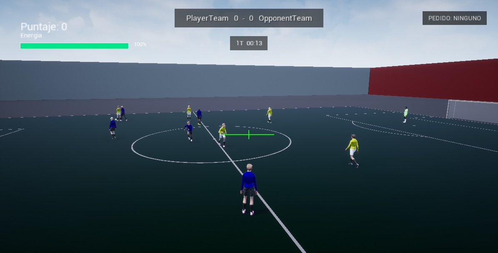
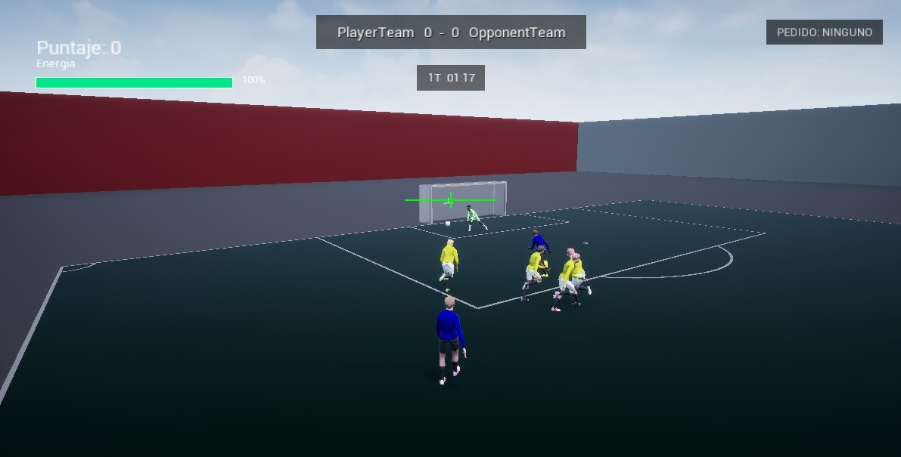
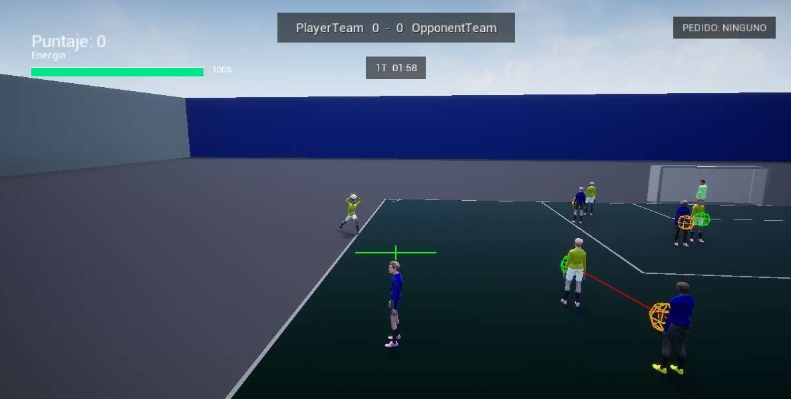

# Futbol7

[English](README.md)


**Futbol7** es un proyecto de jugabilidad y simulación de fútbol 7 desarrollado principalmente en **C++ con Unreal Engine 4.27**.

El foco del proyecto está puesto en los sistemas: inteligencia artificial táctica, reglas de partido, interacción jugador/pelota, arqueros, formaciones, sustituciones, atributos, acciones sincronizadas con animaciones y repetición instantánea.

El objetivo es construir un partido en el que el jugador controlado por una persona y los compañeros/rivales controlados por IA funcionen bajo las mismas reglas e interactúen mediante sistemas tácticos, físicos y de estado de partido compartidos.

> **Nota técnica:** el nombre público del proyecto es **Futbol7**, pero el proyecto de Unreal y el módulo C++ todavía se llaman `ThirdPersonCpp`, porque el desarrollo comenzó originalmente desde el template Third Person de Unreal.

> Este repositorio representa una versión de desarrollo; no es todavía un juego comercial terminado ni un release empaquetado.

---

## Capturas del gameplay

<p align="center">
  
</p>

<p align="center">
  
</p>

<p align="center">
  
</p>

---

## Puntos destacados de ingeniería

Futbol7 es principalmente un proyecto de programación de gameplay e inteligencia artificial. El código actualmente incluye sistemas para:

- IA contextual con fases ofensiva, defensiva y neutral
- intercepción predictiva de la pelota
- pases, remates, dribble y autopases
- apoyo, presión, cobertura, marcaje y desmarques tácticos
- posicionamiento, atajadas, capturas y distribución de arqueros
- manejo de estados para reglas y reanudaciones
- saque del centro, lateral, tiro libre, córner, saque de arco, offside y penal
- clases separadas de configuración / preparación / ejecución
- tackles, faltas y reacciones de caída
- acciones aéreas y planificación de intercepción
- nueve formaciones de fútbol 7
- perfiles de DT y planificación del Coach AI
- planteles, banco, fatiga y sustituciones
- presets tácticos persistentes y tácticas rápidas
- atributos físicos, técnicos, tácticos y de arquero
- personalización de apariencia y variantes corporales
- primer tiempo, entretiempo y segundo tiempo
- geometría de cancha derivada de dimensiones centralizadas
- instant replay mediante ring buffer y múltiples cámaras
- herramientas específicas de debug de gameplay

---

## Arquitectura general

```text
                    ┌─────────────────────────────┐
                    │      SoccerMatchManager     │
                    │                             │
                    │ Flujo / reglas / equipos    │
                    │ posesión / períodos         │
                    │ cambios / Coach AI          │
                    └──────────────┬──────────────┘
                                   │
          ┌────────────────────────┼────────────────────────┐
          │                        │                        │
          ▼                        ▼                        ▼
┌──────────────────┐    ┌────────────────────┐    ┌────────────────────┐
│ Estados partido  │    │ IA jugador/equipo  │    │ Perfiles jugador   │
│                  │    │                    │    │ Perfiles DT        │
│ Saque centro     │    │ Posicionamiento    │    │ Formaciones        │
│ Lateral          │    │ Pases              │    │ Presets tácticos   │
│ Tiro libre       │    │ Intercepción       │    │ Plantel / once     │
│ Córner           │    │ Marcaje / apoyo    │    │ Atributos          │
│ Saque arco       │    │ Arqueros           │    │ Apariencia         │
│ Offside          │    │ Juego aéreo        │    └────────────────────┘
│ Penal            │    │ Tackles            │
└──────────────────┘    └──────────┬─────────┘
                                   │
                                   ▼
                         ┌────────────────────┐
                         │ Pelota / animación │
                         │ física / NavMesh   │
                         └────────────────────┘

          ┌────────────────────────┴────────────────────────┐
          ▼                                                 ▼
┌────────────────────┐                            ┌────────────────────┐
│ Geometría cancha   │                            │ Instant replay     │
│ dimensiones únicas │                            │ snapshots muestreados│
└────────────────────┘                            └────────────────────┘
```

La arquitectura continúa evolucionando a medida que los sistemas se prueban y refactorizan.

---

## Sistema de estados del partido

Las reanudaciones se modelan mediante estados explícitos de gameplay en lugar de resolverse como eventos aislados.

Existen clases específicas para situaciones como:

```text
Juego normal
Saque del centro
Lateral
Córner
Saque de arco
Tiro libre / falta
Offside
Penal
Delay de pelota afuera
```

Varias reanudaciones están separadas en tres etapas:

```text
Configuración
    ↓
Preparación
    ↓
Ejecución
```

Esto permite coordinar:

- ubicación de la pelota
- selección del ejecutante
- posicionamiento de compañeros
- restricciones del rival
- bloqueo/desbloqueo de input humano
- timing de animaciones
- regreso al juego abierto

Este diseño también permite ir sacando comportamiento específico del `SoccerMatchManager`.

---

## Inteligencia artificial táctica

Los bots no están diseñados solamente para perseguir la pelota.

Cada equipo trabaja con fases generales:

```text
Neutral
Atacando
Defendiendo
```

Según el contexto, la IA puede recibir órdenes como:

### En ataque

- recuperar una pelota libre
- ofrecer apoyo corto
- ofrecer apoyo hacia adelante
- desmarcarse
- dar amplitud
- mantener rest-defense
- compensar la posición de un compañero

### En defensa

- presionar al poseedor
- proteger la línea hacia el arco
- cubrir el centro
- mantener un bloque compacto
- marcar receptores peligrosos

La intención es que las decisiones individuales estén subordinadas a la situación táctica colectiva.

---

## Intercepción predictiva

La persecución puede utilizar **puntos futuros de intercepción** en lugar de limitarse a seguir la posición actual de la pelota.

El sistema maneja información como:

- posición predicha
- muestras de trayectoria
- tiempos de llegada
- tiempo necesario para girar
- márgenes de seguridad
- condiciones de intercepción terrestre o aérea

La lógica se reutiliza en distintos sistemas y también puede intervenir en la persecución del jugador humano para los modos de input correspondientes.

---

## Pases y dribble

El proyecto distingue distintas intenciones de progresión con pelota:

- pase normal
- pase solicitado por el humano
- pase aéreo
- pase al espacio
- autopase / toque de conducción
- pase durante una reanudación

La IA también tiene en cuenta la intención de un pase para evitar que un compañero trate inmediatamente una pelota enviada deliberadamente como si fuera una pelota libre sin destinatario.

La conducción utiliza evaluación espacial y toques físicos controlados, en lugar de depender solamente de mantener la pelota permanentemente unida al personaje.

---

## Sistemas del arquero

Los arqueros utilizan lógica específica en lugar de comportarse como jugadores de campo.

Entre los sistemas implementados y en evolución se encuentran:

- posicionamiento dinámico respecto de pelota y arco
- planificación de respuesta ante remates
- múltiples acciones de atajada/captura
- posesión con las manos
- posesión protegida mientras sostiene la pelota
- distribución con la mano
- drop kick y colocación de pelota para sacar
- posicionamiento en penales
- regreso hacia el arco
- ventanas de contacto ligadas a animaciones

Las acciones incluyen diferentes tipos de captura, bloqueo, desvío y volada.

---

## Formaciones y táctica colectiva

Futbol7 define actualmente **nueve formaciones de fútbol 7**:

```text
1-3-2-1
1-2-3-1
1-3-3
1-2-2-2
1-3-1-2
1-2-1-2-1
1-2-1-3
1-4-1-1
1-5-1
```

Cada formación contiene exactamente siete posiciones estructurales:

```text
1 arquero + 6 jugadores de campo
```

Los slots de formación se describen independientemente de los roles generales de gameplay, permitiendo que un mismo rol pueda ocupar distintas líneas o carriles tácticos.

También existen:

- planes tácticos colectivos
- instrucciones individuales
- presets tácticos persistentes
- accesos de táctica rápida
- interfaz de formación / DT durante el juego

---

## Coach AI

Los directores técnicos se representan mediante perfiles independientes y data-driven.

Un perfil de DT contiene conceptos como:

### Filosofía

- intención ofensiva
- preferencia por posesión
- juego directo
- intensidad de presión
- altura de línea defensiva
- ancho del equipo
- compactación
- tempo
- preferencia de contraataque
- tolerancia al riesgo

### Selección de jugadores

- prioridad de posición natural
- encaje táctico
- nivel actual
- condición física
- rotación
- preferencia por juventud
- versatilidad del banco

### Capacidades del DT

- evaluación de jugadores
- lectura de partido
- flexibilidad táctica
- coaching ofensivo/defensivo
- manejo de fatiga
- timing de sustituciones
- compostura

La lógica puede construir planes previos al partido y también tomar decisiones durante el encuentro.

---

## Planteles, fatiga y sustituciones

El estado del plantel durante el partido está separado del perfil permanente de cada jugador.

El sistema de cambios contempla:

- once inicial y banco
- historial de sustituciones
- límite máximo de cambios
- solicitud de un cambio
- ejecución durante una pausa apropiada
- selección de cambios por parte del humano
- decisiones automáticas del Coach AI rival
- consideración de fatiga

Esto permite mantener separada la identidad/atributos permanentes del estado temporal del partido.

---

## Perfiles y atributos de jugador

Los futbolistas se representan mediante perfiles con identificadores estables.

Los atributos se dividen en distintos grupos.

### Físicos

```text
Velocidad
Aceleración
Resistencia
Recuperación de energía
Fuerza
Agilidad
Balance
```

### Técnicos

```text
Control de pelota
Dribbling
Precisión de pase
Precisión de remate
Potencia de remate
Tackle
Juego aéreo
```

### Tácticos

```text
Reacción defensiva
Anticipación
Posicionamiento sin pelota
Posicionamiento defensivo
Marcaje
Toma de decisiones
Compostura
```

### Arquero

```text
Reflejos
Posicionamiento
Manejo
Volada
Distribución
```

Los atributos buscan modificar consecuencias reales del gameplay y no funcionar únicamente como estadísticas de presentación.

Por ejemplo, fuerza y juego aéreo participan en disputas físicas/aéreas, mientras que la evaluación de una alineación pondera atributos relevantes para cada slot táctico.

---

## Apariencia de jugadores

La identidad del jugador está separada de la identidad del club.

Existe un catálogo central de apariencia que utiliza identificadores estables `BodyVariantId` para resolver distintas variantes corporales hacia diferentes Skeletal Meshes.

Los perfiles pueden almacenar características individuales, mientras que los elementos visuales propios del club pueden manejarse por separado.

---

## Geometría de la cancha

Una regla arquitectónica importante del proyecto es evitar distribuir coordenadas hardcodeadas por las distintas clases.

`SoccerFieldDimensions.h` centraliza elementos como:

- largo y ancho
- laterales y líneas de fondo
- áreas
- área de meta
- punto penal
- círculo central / distancia de reanudación
- arcos
- geometría de córners

La cancha de referencia actual mide:

```text
60 m × 40 m
```

Distintas distancias tácticas originalmente calibradas para esa cancha se escalan respecto de las dimensiones configuradas.

La geometría se define en el espacio local del actor de cancha y luego se transforma al espacio del mundo, evitando que las reglas dependan de una posición/rotación fija del estadio.

---

## Tiempo de partido y cambio de campo

El sistema contempla períodos explícitos y HUD para:

```text
Primer tiempo
Entretiempo
Segundo tiempo
Finalizado
```

También maneja el cambio de lado entre tiempos para que los cálculos relativos a ataque, táctica y arqueros sigan funcionando luego de invertir los campos.

---

## Instant replay

Futbol7 posee un sistema de repetición instantánea implementado en C++.

En lugar de volver a ejecutar decisiones de IA para reconstruir el pasado, el recorder almacena **estado visual y físico muestreado**.

Se registran datos como:

- transforms y velocidades de jugadores
- estado de movimiento
- flags relevantes de gameplay
- estado del montage activo
- transform de la pelota
- velocidad lineal y angular
- estado físico de la pelota
- attachments de la pelota

La configuración por defecto mantiene aproximadamente:

```text
10 segundos de historial
30 muestras por segundo
```

mediante un ring buffer.

El replay manual puede reproducir los últimos cinco segundos y el replay de gol utiliza varias cámaras alrededor del arco.

Al terminar la repetición se restaura el estado vivo del partido.

---

## Sincronización animación/gameplay

Las animaciones forman parte de la lógica y no se utilizan solamente como presentación visual.

El proyecto utiliza:

- Animation Blueprints
- Animation Montages
- Anim Notify States
- ventanas de contacto para el arquero
- timing de contacto en patadas
- tackles y caídas
- animaciones de lateral
- acciones aéreas

Para distintas acciones, el evento físico sobre la pelota ocurre en el momento de contacto definido por la animación y no inmediatamente cuando la IA toma la decisión.

---

## Tackles, faltas y juego aéreo

El gameplay contempla:

- tackles deslizantes
- contacto pelota/jugador
- detección de faltas
- penales por falta dentro del área
- reacciones de caída
- recuperación posterior
- planes de intercepción aérea
- cabezazos parado
- cabezazos con salto
- control con el pecho
- disputas aéreas

El timing de la animación, los atributos y la trayectoria de la pelota pueden participar en el resultado.

---

## Herramientas de debug

Existe una capa de debug específica para inspeccionar:

- decisiones de IA
- formaciones / shape del equipo
- intercepción predictiva
- juego aéreo
- tackles
- pelota
- decisiones del arquero
- objetivos de movimiento
- transiciones del estado del partido

También existen actores de prueba específicos para remates al arquero y acciones aéreas.

Estas herramientas son importantes porque muchos errores de un juego de fútbol aparecen por la interacción entre navegación, reglas, física, animación e IA.

---

## Tecnologías

- Unreal Engine 4.27
- C++
- Visual Studio 2022 como entorno de desarrollo
- Unreal Navigation / NavMesh
- Animation Blueprints y Montages
- Unreal Data Assets
- Unreal SaveGame
- Blender
- flujo de personajes/animaciones basado en Mixamo
- Git LFS para archivos `.uasset` y `.umap`

---

## Estructura del repositorio

La mayor parte del código se encuentra en:

```text
Source/ThirdPersonCpp/
```

Algunos componentes:

```text
SoccerMatchManager.*              coordinación del partido
SoccerAIController.*              decisiones de IA
SoccerCharacterBase.*             sistemas compartidos de jugadores
SoccerBall.*                      comportamiento de pelota
SoccerField.*                     geometría/world transform
SoccerFieldDimensions.h           dimensiones centralizadas

Soccer*ConfigurationState.*       configuración de reanudaciones
Soccer*PreparationState.*         preparación
Soccer*ExecutionState.*           ejecución

SoccerFormation*.*                formaciones / UI
SoccerCoach*.*                    perfiles y planificación del DT
SoccerTacticalPreset*.*           presets tácticos persistentes
SoccerPlayerProfile*.*            identidad y atributos
SoccerInstantReplayManager.*      grabación/reproducción del replay

SoccerDebugManager.*              controles centralizados de debug
```

---

## Ejecutar el proyecto

### Requisitos

- Unreal Engine **4.27**
- herramientas de compilación C++ / Visual Studio
- Git LFS

Clonar:

```bash
git lfs install
git clone https://github.com/SurvilaDeveloper/futbol7.git
cd futbol7
git lfs pull
```

Abrir:

```text
ThirdPersonCpp.uproject
```

Si Unreal solicita recompilar el módulo C++, permitir la compilación.

Para trabajar desde Visual Studio se pueden generar los project files desde el `.uproject` y compilar el target del Editor antes de abrir el proyecto.

> El módulo interno de Unreal todavía se llama `ThirdPersonCpp`.

---

## Estado del proyecto

Futbol7 se encuentra en desarrollo activo.

Muchos sistemas ya funcionan, pero continúan siendo probados y refactorizados a medida que nuevas interacciones exponen casos límite.

El fútbol es especialmente exigente porque una misma situación puede involucrar simultáneamente:

```text
reglas
IA
navegación
física
animaciones
input
táctica colectiva
estado del partido
```

Por eso el repositorio debe evaluarse principalmente como un **proyecto de ingeniería de gameplay e IA**, no como un producto visual terminado.

Actualmente no existe un release público empaquetado del juego en este repositorio.

---

## Dirección de desarrollo

Trabajo actual y futuro:

- seguir separando sistemas grandes en módulos más claros
- mejorar decisiones tácticas
- refinar el comportamiento de arqueros
- mejorar interacción física jugador/pelota
- ampliar pruebas reproducibles de gameplay
- mejorar juego aéreo
- continuar sincronización animación/gameplay
- profundizar sistemas de gestión de equipo
- continuar pulido visual y variantes de personajes
- preparar la arquitectura para trabajo futuro de multijugador

---

## Autor

**Gabriel Survila**

GitHub: [SurvilaDeveloper](https://github.com/SurvilaDeveloper)
